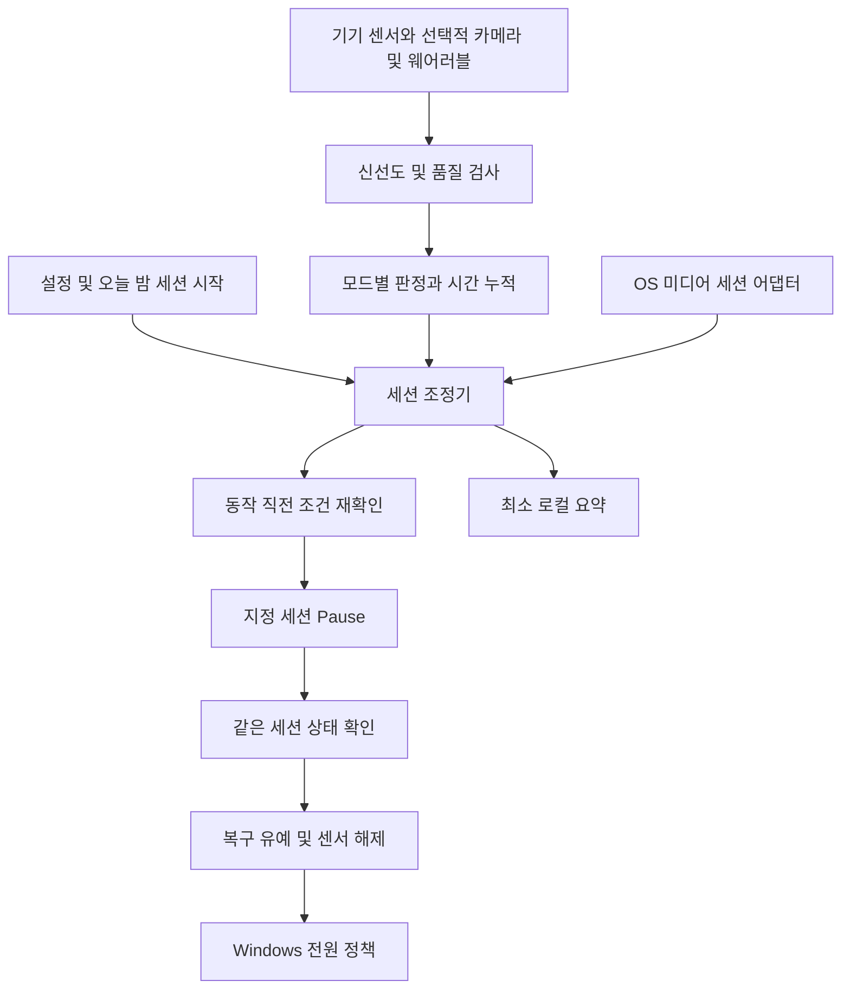

# SleepSense 최종 개발 설계서

버전 1.1 · 기준일 2026년 10월 10일 · 대상 Android 스마트폰과 Windows LG그램 노트북

## 1 제품 목표와 확정 설계

SleepSense는 야간에 동영상이나 음악을 재생하다 잠든 사용자를 위해, 사용자가 선택한 미디어의 재생을 중단하고 감지 장치도 함께 해제하는 개인용 프로그램이다. 목표는 불필요한 재생 시간과 **감지 비용을 포함한 순전력 소비**를 줄이는 것이다.

개발은 **Android의 카메라 없는 야간 보호 기능을 최우선으로 시작**한다. 사용자 확인 우선 대상은 Samsung S26 Ultra 512 GB이며, 빛이 없는 환경을 기본 사용 조건으로 둔다. Windows의 눈 감김 기반 영상 종료는 Android MVP 이후 구현한다. 실제 수면 진입 추정은 사용할 수 있는 생체 신호와 기기별 검증이 확보될 때 추가한다. 스마트워치 보유 여부와 LG그램 모델명이 확인되지 않았으므로, 시계·적외선 카메라·NPU를 필수 조건으로 삼지 않는다.

확정 원칙은 다음과 같다.

1. 센서 부족, 얼굴 이탈, 저조도, 데이터 지연을 수면 증거로 계산하지 않는다.
2. 앱이 실제로 제공하는 미디어 세션을 지정하여 일시정지한다. 볼륨 뮤트, Space 키, 재생과 정지를 뒤집는 토글 키는 자동 제어 경로에서 제외한다.
3. 일시정지를 확인한 뒤에만 복구 유예와 Windows 전원 동작을 진행한다.
4. Android와 Windows는 각각 독립 실행한다. 서버, 계정, 기기 간 자동 동기화는 v1에 필요하지 않다.
5. 카메라 영상·오디오 원본은 메모리에만 둔다. 감지 서비스는 외부 서버로 데이터를 전송하지 않는다.
6. 수면 추정, 눈 감김 종료, 무활동 종료를 UI와 기록에서 구분한다. 눈 감김이나 휴대폰 정지 상태만으로 실제 수면을 확정했다고 표시하지 않는다.

이 문서는 구현 기준이다. 문서의 기본값과 성능 목표는 설계값이며, 아직 실제 스마트폰이나 LG그램에서 측정된 결과가 아니다. 수면 단계 분류와 의료적 판단은 제품 범위에 포함하지 않는다.

### 1.1 사용자에게 제공하는 모드

| 모드 | 판정에 사용하는 근거 | 우선 대상 | v1 상태 |
| --- | --- | --- | --- |
| 눈 감김 종료 | 유효한 얼굴·눈 관측과 일정 시간의 눈 감김 | Windows 영상 시청 | 구현 대상 |
| 무활동 보호 | 지정 재생 중 기기 움직임 또는 사용자 입력이 없는 시간 | Android 영상·음악, Windows 음악 | 구현 대상, 수면 판정 아님 |
| 최대 재생시간 | 사용자가 선택한 재생 시간 상한 | 양 플랫폼 | 별도 선택 기능 |
| 생체 신호 수면 추정 | 지연이 검증된 웨어러블 상태·심박·움직임 | 영상·음악 | 확장 단계 |
| 카메라 또는 오디오 보조 | 명시적으로 허용한 센서, 품질 검사를 통과한 관측 | Android 카메라, 양 플랫폼 오디오 | 실험 기능, 기본 꺼짐 |

음악을 들으며 눈을 감고 쉬는 상황은 정상 사용일 수 있다. 따라서 음악 모드에서는 눈 감김 종료를 기본 적용하지 않는다. 사용자가 직접 선택했을 때만 적용한다. 실제 수면 신호를 얻을 수 없는 환경에서는 보호 타이머가 목적을 부분적으로 달성하며, 센서 기반 수면 추정을 대신했다고 주장하지 않는다.

### 1.2 v1 범위

포함: 야간 세션 시작·종료, 대상 미디어 지정, Windows 비전 검사, Android 움직임 기반 보호, 지정 세션 일시정지 및 결과 확인, 오탐 복구, Windows 화면 끄기 선택, 센서 상태 안내, 로컬 요약 기록, 호환성 확인.

확장: 웨어러블, 호흡·코골이 보조 분류, Windows 절전, Android 카메라 실험, 하드웨어 가속.

제외: 앱 강제 종료, 기기 종료, 임의 앱 화면 터치, 모든 브라우저 탭 식별 보장, 스트리밍 앱의 DRM 우회, 원격 Cast 기기 제어, 의료용 수면 분석, 중앙 서버.

## 2 플랫폼 지원과 선행 확인

### 2.1 지원 기준

- Android: 최소 Android 12, API 31을 개발 기준으로 한다. compileSdk와 targetSdk는 배포 시점의 안정 SDK 및 배포 채널 요구에 맞춰 고정한다. 실제 사용 스마트폰은 필수 검증 기기다.
- Windows: Windows 11 x64의 지원 중인 버전을 제품 기준으로 한다. Python 환경에서 카메라·MediaPipe·WinRT 패키지를 함께 설치할 수 있는 조합을 먼저 검증한다. Windows 10과 ARM64는 초기 지원 대상에서 제외한다.
- LG그램: 제조사 이름만으로 카메라 성능, NPU, 적외선 영상 접근, Modern Standby 지원을 추정하지 않는다.
- 웨어러블: 없어도 설치와 보호 모드를 사용할 수 있다. 모델·OS·착용 상태·지원 데이터·전송 경로가 검증된 장치만 추정 모드에 등록한다.

### 2.2 최초 실행의 기능 확인

사용자가 실제로 쓰는 앱으로 30초짜리 테스트 미디어를 재생한 뒤, 세션 탐지 → 지정 일시정지 → 상태 확인 → 사용자가 누른 재생 복구를 시험한다. 이 테스트는 사용자가 시작하며, 일반 미디어를 자동으로 정지시키는 첫 실행 동작은 두지 않는다.

결과를 `지원`, `부분 지원`, `미지원`, `미검증`으로 저장한다. YouTube·Netflix·Spotify라는 이름만으로 지원을 선언하지 않는다. Android 앱 버전, PC 브라우저 종류, 데스크톱 앱, PWA, 전체화면, 화면 잠금 여부를 별도 조합으로 기록한다.

| 기능 확인 항목 | 성공 조건 | 실패 시 처리 |
| --- | --- | --- |
| 지정 세션 발견 | 재생 중이며 사용자 지정 대상과 일치 | 대상 선택을 다시 안내, 자동 제어 비활성 |
| Pause 지원 | 상태·지원 명령이 확인됨 | 미지원 표시, 입력 키로 우회하지 않음 |
| Pause 결과 | 명령 후 같은 세션이 Paused로 전환 | 실패 기록, 전원 동작 금지 |
| Play 복구 | 같은 세션에 한해 명시적 재생 가능 | 복구 버튼 비활성, 앱에서 재생 안내 |
| 카메라 품질 | 얼굴·두 눈·자세·조명이 기준을 통과 | 보호 모드 선택 안내 |
| 백그라운드 유지 | 실제 기기에서 세션·센서 업데이트 지속 | 자동 감지 지원 제한 표시 |
| 전원 동작 | 해당 LG그램에서 화면 꺼짐 및 복귀 확인 | 해당 옵션 비활성 |

브라우저 세션이 탭을 구분하지 못하면 브라우저 전체를 대상으로 설명하고, 여러 탭이나 세션이 모호한 동안 자동 동작을 보류한다.

## 3 요구사항과 완료 조건

아래의 MUST는 필수 구현, SHOULD는 목표, MAY는 선택 확장을 뜻한다. 원 명세의 Req ID를 유지하되 구현 가능한 범위로 확정한다.

| ID | 최종 요구사항 | 단계 | 완료 조건 |
| --- | --- | --- | --- |
| REQ-01 | 생체 데이터는 공급 장치와 지연을 검증한 어댑터로 받는다. Health Connect 기록은 실시간 진입 트리거로 쓰지 않는다 | 확장 | 착용·신선도·실제 지연·로컬 전송 확인 |
| REQ-02 | 눈 감김을 개인 보정값과 유효 관측 시간으로 판정한다 | Windows v1 | 저조도·얼굴 이탈을 UNKNOWN 처리, 시간 누적 테스트 통과 |
| REQ-03 | 호흡·코골이 분류는 선택적 보조 증거로 사용한다 | 확장 | 재생음·TV 소리·동거인 소리 오염 시험 통과 |
| REQ-04 | 지정 미디어 세션의 실제 Playback 상태를 모니터링한다 | v1 | 무음 영상도 세션으로 발견, 다른 앱 소리만으로 동작하지 않음 |
| REQ-05 | 지정 세션에 멱등적 Pause를 보내고 결과를 확인한다 | v1 | 다른 세션·이미 정지된 세션을 재생시키지 않음 |
| REQ-06 | Windows 화면 끄기는 선택 기능, 절전은 추가 검증 후 선택 기능으로 제공한다 | v1 및 확장 | Pause 확인 및 복구 유예 완료 후만 실행 |
| REQ-07 | SleepSense가 정지한 동일 세션만 정해진 시간 내 복구한다 | v1 | 수동 정지·새 세션·앱 재시작 이후 자동 재생 0건 |
| REQ-08 | 센서 가용성과 품질을 판정 근거와 별개로 관리한다 | v1 | 권한 취소·센서 중단 시 수면 판정으로 승격되지 않음 |
| REQ-09 | 원본 프레임·PCM과 생체 시계열을 저장·전송하지 않는다 | v1 | 네트워크·파일 검사 통과 |
| REQ-10 | 감지로 절약한 전력이 감지 비용보다 커야 한다 | v1 | 동일 조건 비교에서 순소비 감소 확인 |
| REQ-11 | 재부팅·프로세스 복구 뒤 자동 재생과 오래된 판정을 실행하지 않는다 | v1 | 비정상 종료 시나리오 통과 |
| REQ-12 | 지원되지 않는 제어와 감지 한계를 UI에 표시한다 | v1 | 미검증 조합은 성공으로 표시되지 않음 |

## 4 전체 아키텍처



### 4.1 모듈 책임

| 모듈 | 책임 | 하지 않는 일 |
| --- | --- | --- |
| CapabilityProbe | OS·권한·센서·세션 제어 지원 확인 | 이름만으로 호환성 추정 |
| SensorAdapter | 측정 시각과 품질을 붙여 관측 제공 | 수면 여부 확정 |
| QualityGate | 조명·추적·착용·지연·누락 평가 | 불량 데이터를 0으로 대체 |
| EvidenceEngine | 모드별 규칙·시간창·초기화 | OS 명령 실행 |
| SessionOrchestrator | 상태기계, 세션 수명, 야간 범위, 해제 | 개별 앱 우회 제어 |
| MediaAdapter | 세션 발견, targeted pause/play, 결과 확인 | 전역 키·임의 클릭 |
| ActionTransaction | 정지 소유권과 복구 가능성 관리 | 다른 세션 재생 |
| PowerPolicy | Windows 전원 유예와 취소 | 앱 프로세스 강제 종료 |
| SummaryStore | 설정·동작 이유·집계 저장 | 원본 영상·음성·건강 이력 보관 |

감지와 제어는 이벤트 큐로 연결한다. OS 콜백에서 바로 일시정지하지 않는다. 상태 변경은 단일 조정기에서 직렬 처리하고, 센서 분석 작업은 제한된 작업자에서 처리한다. 영상 큐는 최신 프레임 위주로 길이 1~2를 유지하며, 밀린 프레임을 나중에 분석해 수면 시간을 누적하지 않는다.

### 4.2 공통 규칙의 공유 방식

Android는 Kotlin, Windows는 Python으로 각자 구현한다. 공통 규칙은 `policy.schema.json`, 상태 전이 사례, 합성 관측 시퀀스로 공유한다. JNI나 공통 네이티브 런타임은 v1에서 도입하지 않는다. 동일 입력 시퀀스가 양 플랫폼에서 같은 정책 결과를 내는지 계약 테스트로 확인한다.

## 5 관측과 판정 규칙

### 5.1 데이터 계약

모든 관측은 아래 정보를 가진다. `value=null`은 측정 불능이고, 0은 실제 측정값이다.

```text
Observation
  source                 vision | device_motion | pc_input | wearable | audio
  source_instance_id     공급 소스의 부팅 또는 연결 회차 ID
  sample_monotonic_ms    측정 시각
  received_monotonic_ms  수신 시각
  value                  구조화된 특징 또는 null
  quality                0..1 또는 unknown
  status                 valid | low_quality | unavailable | stale | off_body
  sequence               소스 내 증가 번호
  provider_version       특징 정의 및 어댑터 버전

Decision
  mode                   eye_closure | inactivity | max_duration | sleep_estimate
  eligible               동작 자격 여부
  evidence_score         0..100 또는 null
  reason_codes           판정 근거
  valid_coverage         유효 관측 시간 비율
  candidate_since_ms     현재 후보 시작 시각 또는 null
```

시간 누적에는 Android `elapsedRealtime` 및 Windows의 단조 증가 시계를 쓴다. 달력 시각은 UI와 야간 허용 시간에만 쓴다. 다른 장치의 시각을 그대로 같은 단조 시계로 취급하지 않는다. 웨어러블은 clock offset과 전송 지연을 검증하고, 정렬을 못 하면 stale 처리한다. 역순·중복 이벤트는 버리고, 재부팅·절전 복귀·긴 측정 공백에서 후보를 초기화한다.

### 5.2 점수의 의미

v1의 0~100 값은 **해당 모드의 종료 근거 점수**이며 수면 확률이 아니다. 기본 UI에서는 점수 대신 `관찰 중`, `눈 감김 확인 중`, `센서 확인 어려움`을 표시한다. 디버그 화면에서만 점수·관측 범위를 볼 수 있다.

눈 감김 점수는 유효하게 관측한 시간 중 양쪽 눈이 감긴 비율 × 100이다. 누락된 시간을 분모에서 빼더라도, 별도의 coverage 조건을 반드시 만족해야 한다. 무활동과 최대 시간 모드는 남은 시간을 표시하고 수면 점수를 만들지 않는다.

확장 수면 모델은 검증된 데이터와 교정 절차가 있기 전까지 확률 표시를 하지 않는다. 센서 수가 줄었다고 남은 센서의 가중치를 재정규화해 판정 기준을 쉽게 넘기지 않는다. 필수 채널을 잃으면 해당 프로파일을 보류한다.

### 5.3 Windows 눈 감김 프로파일

EAR은 각 눈의 여섯 점을 눈둘레 순서로 배치하여 계산한다.

```text
EAR = (distance(p2,p6) + distance(p3,p5)) / (2 * distance(p1,p4))
```

랜드마크의 정규화 좌표는 프레임 폭·높이를 반영한 픽셀 좌표로 바꿔 거리를 계산한다. 분모가 너무 작거나 눈 영역이 흐리면 관측을 버린다. 랜드마크 인덱스와 모델 파일 hash를 함께 고정한다.

처음 설정할 때 현재 사용 거리와 조명에서 눈 뜸 20초, 의도적 눈 감김 10초를 측정한다. 눈 뜸과 감김 분포가 충분히 분리되지 않으면 보정을 실패로 처리한다. 초기 실험식은 `T_close = E_closed + 0.35 × (E_open − E_closed)`, `T_open = E_closed + 0.55 × (E_open − E_closed)`로 두어 히스테리시스를 제공한다. 이 계수는 데이터로 조정할 값이며 보편적 생리 기준이 아니다.

보통 프로파일의 동작 조건은 다음과 같다.

1. 지정 세션이 Playing이고, 현재 로그인 사용자 세션에 최근 120초 입력이 없다.
2. 유효한 얼굴과 양쪽 눈에서 5초 이상 눈 감김이 관측되어 확인 단계로 들어간다.
3. 확인 단계에서 2 fps로 180초 동안 관측한다. 유효 coverage ≥ 80%, 종료 근거 점수 ≥ 90을 모두 만족해야 한다.
4. 유효한 눈 뜸이 2초 지속되거나 사용자 입력이 발생하면 후보를 취소한다.
5. 측정 간격이 2초를 초과하거나 얼굴·조명·추적 실패가 2초를 초과하면 확인 시간을 초기화한다. 해당 구간을 감김으로 연장하지 않는다.
6. 마지막 5초도 품질을 통과한 눈 감김이어야 한다. 이후 15초 취소 유예를 거쳐 동작 직전 조건을 다시 확인한다.

coverage와 점수는 프레임 개수가 아닌 측정 시각 간격을 상한 처리하여 시간 기준으로 계산한다. 위 조건은 샘플링 기반의 장시간 눈 감김 관측이다. 임상적 수면 확정이나 모든 순간의 연속 감김을 의미하지 않는다.

기본은 얼굴 한 명인 환경이다. 얼굴 수·대상 일관성 검사로 두 명 이상 또는 대상 전환 가능성이 보이면 보류한다. 눈 랜드마크 모델의 `num_faces=1` 설정만으로 장면에 다른 사람이 없음을 보장하지 않는다. 얼굴 인식용 신원 템플릿은 만들지 않는다.

### 5.4 Android 무활동 보호 프로파일

기기 가속도는 사용자 몸의 움직임이 아니라 **휴대폰의 움직임**이다. 휴대폰을 거치대에 놓고 시청하는 사용자를 수면으로 분류하지 않는다.

- 활성 세션에서만 가속도를 초기 10 Hz로 수집한다. 중력 성분을 제거한 움직임 크기·방향 변화를 30초 창으로 계산한다.
- 최초 30초 정지 보정으로 센서 잡음 범위를 얻는다. 단일 스파이크는 입력으로 세지 않고, 보정값을 넘는 움직임이 2초 이상 지속되면 활동으로 처리한다.
- 사용자가 앱의 계속 보기/계속 듣기 버튼을 누르거나, 유효한 기기 이동·잠금 해제 이벤트가 발생하면 무활동 카운트다운을 초기화한다.
- 기본 무활동 제한은 45분이며 사용자가 15~120분 중 선택한다. 센서 가용성이 유지되고 지정 미디어가 Playing인 구간에만 누적한다.
- 센서가 5초 넘게 stale이거나 백그라운드 수집이 중단되면 연속 무활동 누적을 폐기한다. 정상 관측 복귀 뒤 새 45분 창을 시작한다. 공백 동안의 활동을 놓쳤을 수 있으므로 이전 누적을 이어 붙이지 않는다. 별도로 선택한 최대 재생시간 정책은 센서 공백과 독립적으로 유지할 수 있다.
- 화면 켜짐만으로 활동을 확정하지 않는다. 알림이 화면을 켤 수 있다. 다른 앱에서의 모든 터치는 관측 가능하다고 전제하지 않는다.

영상·음악 유형은 사용자가 프로파일에서 지정한다. 미디어 메타데이터만으로 정확히 자동 분류할 수 있다고 가정하지 않는다. Android의 일반 알림 접근이 허용되어도 다른 앱 화면의 전역 터치를 읽을 수 있는 것은 아니다.

Windows의 무활동 보호는 휴대폰 모션 대신 현재 사용자 세션의 마지막 입력 시각을 사용한다. 기본 45분 동안 입력 없이 지정 미디어가 계속 Playing이면 종료 후보가 된다. 입력 조회 실패·역행·잠금·사용자 전환에서 연속 누적을 폐기한다. 오랫동안 입력 없이 음악을 듣거나 영상을 보는 상황에서도 작동하는 시간 정책임을 시작 화면에 설명한다.

최대 재생시간은 같은 밤의 지정 대상 Playing 시간을 합산한다. 움직임·일반 입력으로 초기화하지 않으며, 사용자 수동 일시정지 중에는 누적하지 않는다. `계속 재생`의 명시적 선택은 새 시간 허용으로 처리하여 해당 카운터를 초기화한다. 대상 세션 교체에서 이전 제한을 새 대상으로 자동 승계하지 않고 사용자가 새 대상을 확인하게 한다.

### 5.5 웨어러블 확장 프로파일

Health Connect는 저장된 건강 기록을 읽는 통합 계층으로 사용한다. 수면 세션 기록의 갱신을 실시간 수면 시작 신호로 쓰지 않는다. 공식 수면 가이드는 SleepSessionRecord를 세션 종료 뒤 작성하도록 명시한다. [Health Connect 수면 가이드](https://developer.android.com/health-and-fitness/health-connect/experiences/sleep)

Wear OS Health Services의 passive 경로에는 수면 관련 `UserActivityState` 후보가 있다. 그러나 데이터는 배치 전달될 수 있고 상태 변경 시각은 과거일 수 있으므로, 실시간성은 장치에서 측정해야 한다. 심박 수집 가능 여부도 capabilities로 확인한다. HRV는 모든 시계에서 같은 경로로 제공된다고 가정하지 않으며, 평균 BPM에서 HRV를 만들어내지 않는다. [Health Services 백그라운드 관측](https://developer.android.com/health-and-fitness/health-services/monitor-background)

확장 승인 조건은 다음과 같다.

- 착용 상태 또는 off-body 배제 방법을 확인한다.
- 실제 상태 변경과 수신 지연의 p50·p95를 측정한다. 초기 신선도 한도 60초를 만족하지 못하는 공급자는 실시간 프로파일에서 제외한다.
- 심박 감소·장치 정지 한 항목만으로 일시정지하지 않는다. 검증된 수면 상태 이벤트와 모순되는 최근 사용자 활동을 먼저 검사한다.
- 지원 모델마다 입력 정의, 특징 창, 모델 버전, 지연, missing-value 처리를 명시한다. 검증된 모델이 없으면 `연구 기능`으로 유지한다.
- 시계 배터리 비용도 순전력 평가에 포함한다.

엄격한 로컬 처리 요구에서 전송 경로도 검증해야 한다. Wear OS Data Layer는 Bluetooth가 없으면 Google 서버를 통해 자동 라우팅할 수 있다. 따라서 기본 설계의 외부 서버 미사용 보장에 맞는 통로로 확정하지 않는다. `isNearby` 확인만으로 외부 전송 불가를 보장하지 않는다. 검증된 로컬 전용 공급 경로가 확보되기 전에는 휴대폰과 연동하는 웨어러블 모드를 배포하지 않는다. 별도 BLE 센서·제조사 SDK도 가능성만으로 채택하지 않고 실제 장치·공식 지원·경로를 확인한다. [Data Layer 전송 경로](https://developer.android.com/training/wearables/data/overview)

### 5.6 오디오 확장 프로파일

스피커에서 재생하는 콘텐츠가 마이크에 다시 들어와 호흡·코골이처럼 분류될 수 있다. 헤드폰 사용 여부만으로 이 문제의 해결을 보장하지 않는다. 초기 오디오 기능은 기본 꺼짐이며, 단독 일시정지 근거로 사용할 수 없다.

16 kHz mono PCM을 모델 입력에 맞게 처리하고 최대 10초 순환 버퍼만 유지한다. clipping·잡음·음악·음성 점유·다른 사람 소리 가능성을 quality gate에서 평가한다. 관측 품질이 낮으면 증거를 버린다. 다른 센서가 어두워졌다는 이유로 오디오 가중치를 높이지 않는다.

MediaPipe Audio Classifier는 모델이 학습한 소리 범주를 출력한다. 해당 분류 점수를 수면 확률로 쓰지 않는다. 재생 콘텐츠에 포함된 코골이, ASMR, 규칙적 음악, TV, 동거인 코골이를 포함한 평가를 통과한 후에만 보조 특징으로 채택한다. 센서 분석을 위해 재생 중인 콘텐츠를 임의로 멈추거나 녹음 권한을 우회하지 않는다. [Audio Classifier 설명](https://developers.google.com/edge/mediapipe/solutions/audio/audio_classifier)

## 6 상태기계와 동작 안전 조건

### 6.1 상태와 전이

| 상태 | 의미 | 다음 상태 |
| --- | --- | --- |
| DISARMED | 오늘 밤 기능이 시작되지 않음 | 사용자 시작 → ARMED |
| ARMED | 권한·대상을 확인하고 재생을 기다림 | Playing → OBSERVING, 종료 → DISARMED |
| OBSERVING | 저비용 관측 또는 보호 시간 누적 | 후보 → VERIFYING, 품질 부족 → DEGRADED |
| VERIFYING | 유효 시간·품질·모순 신호 확인 | 조건 충족 → PRE_PAUSE, 취소 → OBSERVING |
| PRE_PAUSE | 기본 15초 취소 유예 | 최종 확인 → PAUSING, 활동 → COOLDOWN |
| PAUSING | 지정 세션 Pause와 상태 확인 | 확인 → PAUSED_GRACE, 제한 재시도 후 실패 → FAULTED |
| PAUSED_GRACE | 60초 복구 가능 구간, 고비용 센서 해제 | 복구 → COOLDOWN, 만료 → POWER_PENDING 또는 FINISHED |
| POWER_PENDING | Windows 화면 또는 절전 정책 대기 | 취소 → FINISHED, 성공·실패 → FINISHED |
| COOLDOWN | 같은 밤의 반복 오탐 방지 | 15분 경과·Playing → OBSERVING, 반복 한도 → FINISHED |
| DEGRADED | 필요한 센서나 제어를 사용할 수 없음 | 기능 회복 → 새 관측, 승인된 시간 정책 → PRE_PAUSE |
| FAULTED | 내부 오류·작업자 정지 등으로 안전한 실행 불가 | 모든 예약 취소·자원 해제, 사용자 새 시작 필요 |
| FINISHED | 해당 밤의 감지 종료, 자원 해제 | 새 사용자 시작 → ARMED |

PRE_PAUSE 알림은 기본 무음이다. 지원되지 않는 Android 백그라운드 UI를 강제로 띄우지 않는다. 지속 알림 또는 Windows 작은 상태 표시에서 취소·계속 재생을 제공한다. 알림이 전달되지 않아도 성공했다고 기록하지 않는다.

조정기는 센서 heartbeat·확인 단계 deadline·OS 명령 timeout을 별도로 관리한다. 센서 획득은 초기 5초 제한을 두고 실패하면 DEGRADED로 전환한다. 작업자나 동작 큐의 내부 오류·heartbeat timeout은 FAULTED로 전환하여 후보·명령 큐·복구 소유권·전원 예약을 폐기하고 센서를 해제한다. 새 Pause·Play·전원 명령과 자동 재시작을 금지한다. 취소 신호와 operation_id로 늦게 도착한 callback 및 중복 동작을 무효화한다. 장치 close가 지연되면 실패를 기록하고 해당 센서를 다시 획득하지 않는다.

### 6.2 동작 직전 MUST 조건

- 사용자가 현재 세션을 시작했고 허용 시간 안에 있다.
- 지정 세션 식별자·generation이 같고 지금도 Playing이다.
- 대상은 로컬 재생으로 검증되어 있으며 Pause를 지원한다.
- 현재 프로파일의 관측·신선도·시간 조건이 유효하다.
- 사용자 활동, 수동 취소, 대상 변경, 권한 취소 이벤트가 없다.
- 적용 가능한 반복 한도를 넘지 않았다.
- Windows에서는 잠금·사용자 전환·잠금 해제 직후 재검증 정책을 통과한다.
- 충돌하는 통화·녹화·회의 등으로 **알려진** 제외 조건이 없다.

일반 앱이 모든 VoIP 통화나 녹화를 완벽히 알아낼 수 있다고 가정하지 않는다. 사용자 제외 앱과 `지금은 감지 중지` 동작을 함께 제공한다. 알려진 카메라·마이크 점유나 통화 이벤트가 있으면 관측을 즉시 중단한다. 불명확한 상태를 안전하게 검증할 수 없는 프로파일은 보류한다.

### 6.3 시간과 세션 중단

시간은 현재 Playing 구간에만 누적한다. 사용자가 수동 일시정지하면 후보·취소 유예를 지우고 센서를 해제한다. 2분 이내 같은 세션의 재생이 돌아오면 새 후보로 시작할 수 있다. 대상 종료 또는 2분 초과 중단이면 ARMED로 돌아가며 고비용 센서를 열어두지 않는다.

자정이 지나는 허용 시간은 예를 들어 23:00~08:00의 다음 날 종료로 계산한다. 기본 시간대는 기기 현지 시간이다. 시간대·날짜 변경에서 허용 범위를 재검사하고, 금지 시간으로 바뀌면 감지와 동작을 취소한다. 후보 유지 시간은 달력 변경으로 늘어나지 않는다.

## 7 미디어 제어와 오탐 복구

### 7.1 세션 식별

Android는 MediaSession token과 패키지, Windows는 세션 객체와 내부 generation 및 SourceAppUserModelId를 함께 추적한다. 패키지명이나 app ID만으로 동일 세션을 판단하지 않는다. 이벤트 구독 중 세션이 제거·추가되면 generation을 바꾼다. 재생 항목 변경 이벤트도 메모리 내 media_generation으로 추적한다. 복구 유예 중 항목이 바뀌거나 변경 원인을 구분할 수 없으면 복구 자격을 취소한다. 제목·URL을 영구 저장해 항목을 식별하지 않는다. 모호하거나 오래된 참조에는 명령을 보내지 않는다.

단일 대상이 기본이다. 여러 대상을 허용하는 기능을 나중에 추가할 경우 각각 독립된 트랜잭션으로 관리한다. 하나의 Pause 성공을 모든 대상의 성공으로 취급하지 않는다.

### 7.2 일시정지 트랜잭션

```text
PauseTransaction
  operation_id           임의 UUID
  arm_session_id         오늘 밤 세션 ID
  target_handle          메모리 내 OS 세션 참조
  target_generation      세션 교체를 구분하는 번호
  media_generation       현재 재생 항목 변경을 구분하는 번호
  previous_state         Playing만 허용
  command_started_ms
  pause_confirmed_ms     확인되지 않으면 null
  paused_by_sleepsense   결과 확인 후에만 true
  resume_until_ms        기본 pause_confirmed_ms + 60000
  last_external_change   수동·세션 교체 등 감지된 변경
  power_deadline_ms      Windows 선택 기능
```

1. 동작 조건을 다시 읽고 Playing을 확인한다.
2. 같은 세션에 Pause를 한 번 보낸다.
3. 최대 5초 안에 콜백 및 상태 재조회로 Paused 전환을 확인한다. Windows의 명령 반환값만으로 성공을 확정하지 않는다.
4. 실패 시 여전히 같은 세션·Playing·동일 조건인지 확인하고 Pause를 한 번만 재시도할 수 있다. 호출마다 제한 시간을 둔다.
5. 총 두 번 실패하면 제어 실패로 종료한다. 뮤트·키 입력·앱 종료로 우회하지 않는다. 전원 동작도 취소한다.
6. Paused를 확인하면 메모리에만 소유권을 설정하고 복구 유예를 시작한다.

OS가 상태 변경의 원인을 완벽히 제공하지 않으므로 SleepSense의 소유권 기록은 관측 가능한 범위의 보수적 기록이다. 수동 변경 가능성이 있거나 원인 구분이 모호하면 자동 복구 자격을 없앤다.

### 7.3 복구 정책

**기본 복구는 알림 또는 UI의 `계속 재생` 버튼**이다. 그 동작은 현재 트랜잭션을 명시적으로 대상으로 하며, 동일 세션·Paused·복구 기한 내에서만 Play를 보낸다. 세션이 끝났으면 앱을 직접 열어 재생하도록 안내한다.

원 명세의 즉시 복구 기능은 다음 제한 아래 선택 기능으로 제공한다.

- Windows: 60초 내 현재 사용자 세션에서 새 키보드·마우스 활동이 관측되면 복구를 요청할 수 있다. 입력 내용은 수집하지 않는다.
- Android: 화면 알림만으로 복구하지 않는다. 기기 집어 들기처럼 검증된 이동 패턴 또는 사용자 잠금 해제에 따른 복구를 별도 허용할 수 있다. 단일 가속도 스파이크는 복구 신호가 아니다.
- OS 상태 원인을 구분할 수 없는 조합에서는 자동 복구 옵션을 제공하지 않는다. 명시적 버튼만 제공한다.
- 복구는 정확히 한 번만 요청한다. 상태를 확인하고, 결과 불명확 시 반복 Play하지 않는다.
- 복구 또는 수동 재생이 감지되면 모든 전원 예약을 취소하고 15분 cooldown을 둔다.
- 한 밤에 자동 종료를 최대 3회로 제한하고, 사용자의 취소·복구가 2회 발생하면 그 밤의 자동 판정을 중단한다.

60초 이후 사용자 입력은 전원 예약을 취소할 수 있지만 자동 Play를 실행하지 않는다. 앱 재시작·로그아웃·재부팅·절전 복귀 후에는 이전 트랜잭션으로 재생하지 않는다. 복구 메모리는 영구 저장하지 않는다.

## 8 Android 구현 설계

### 8.1 기술 선택

Kotlin, Jetpack Compose, Coroutines/Flow, SensorManager, MediaSessionManager, NotificationListenerService, DataStore를 사용한다. 저장할 이벤트가 필요하면 최소 스키마의 Room을 사용한다. v1 기본 APK에는 카메라·오디오 추론 모델을 필수로 넣지 않는다.

Android와 앱 라이브러리 버전은 잠금 파일과 버전 카탈로그로 고정한다. API 동작은 사용 스마트폰의 OS 버전과 제조사 전원 관리에서 확인한다. WorkManager는 정리·집계 같은 지연 가능 작업에만 사용하며, 즉각적 센서 검사나 정해진 초 단위 제어를 맡기지 않는다.

### 8.2 미디어 세션 접근

사용자가 시스템 설정에서 알림 접근을 허용한 NotificationListenerService의 ComponentName으로 활성 MediaController를 가져오는 경로를 사용한다. 일반 서드파티 앱이 `MEDIA_CONTENT_CONTROL` 권한을 얻는다고 전제하지 않는다. 알림 내용은 수집하거나 저장하지 않는다. OS가 폭넓은 알림 접근을 부여한다는 점은 권한 설명에 명확히 표시한다. [MediaSessionManager](https://developer.android.com/reference/android/media/session/MediaSessionManager)

컨트롤러의 상태·지원 action과 대상 패키지를 확인하고 `transportControls.pause()`를 호출한다. 복구는 트랜잭션을 통과한 같은 컨트롤러의 `play()`를 사용한다. 다른 앱 오디오 포커스의 전체 소유자를 일반 앱에서 언제든 조회할 수 있다고 가정하지 않는다. 오디오 포커스 획득으로 다른 앱을 강제 정지시키는 방식도 사용하지 않는다.

권한 취소·listener 단절에서는 목록을 비우고 제어를 중단한다. 다시 연결되어도 이전 후보와 정지 소유권을 복구하지 않는다. 앱 버전별로 Pause 무시·상태 미갱신·광고 구간 제어 제한을 시험한다.

### 8.3 Foreground Service 구성

야간 세션은 사용자가 앱 화면에서 `오늘 밤 시작`을 눌러 시작한다. 지속 알림에 사용 모드·남은 시간·종료·계속 재생을 제공한다. 재부팅이나 야간 시각 도달만으로 카메라·마이크 서비스를 시작하지 않는다. 자동 야간 일정은 시작 알림 또는 허용 시간 제한으로만 사용한다.

| 기능 | FGS 설계 | 배포 조건 |
| --- | --- | --- |
| 휴대폰 센서 기반 야간 보호 | API 34+에서 `specialUse` 적합성을 검토하고 subtype 설명·권한 선언 | 개인 APK 실기기 검증, Play 배포는 해당 용도 심사 통과 |
| 검증된 외부 기기 연결 | 실제 전송 방식에 맞는 connectedDevice 등 적합 타입 | 연결·권한 조건과 전송 경로 검증 |
| 카메라 실험 | camera 타입, CAMERA 및 해당 FGS 권한 | 앱이 보이는 동안 사용자 시작, 백그라운드 유지 검증 |
| 마이크 실험 | microphone 타입, RECORD_AUDIO 및 해당 FGS 권한 | 앱이 보이는 동안 사용자 시작, 오디오 점유 검증 |

`mediaPlayback`은 SleepSense가 직접 미디어를 재생하는 기능이 아니므로 감시 서비스의 편의적 타입으로 사용하지 않는다. `dataSync`, `shortService`, `health`도 실제 용도·선행 조건에 맞지 않으면 선택하지 않는다. `specialUse`가 기술적으로 가능하다는 이유만으로 Play 배포가 승인된다고 가정하지 않는다. [FGS 타입과 선행 조건](https://developer.android.com/develop/background-work/services/fgs/service-types)

Android 12+의 백그라운드 FGS 시작 제한과 camera/microphone의 while-in-use 제한을 따른다. 따라서 `10분간 움직임 없음 → 그때 백그라운드에서 카메라 새 시작`은 기본 구현에 포함하지 않는다. 이미 적법하게 시작한 카메라 FGS에서 장치를 주기적으로 열고 닫는 동작도 OS·OEM에서 재확인해야 하며, 항상 가능하다고 약속하지 않는다. [백그라운드 FGS 시작 제한](https://developer.android.com/develop/background-work/services/fgs/restrictions-bg-start)

### 8.4 권한과 기기 전원

기본 요구는 사용자가 시작한 foreground 실행과 알림 접근이다. API별 FGS 권한 및 알림 표시 권한을 실제 필요 기능에 맞게 요청한다. 알림 거절 시 OS 실행 요건과 사용자 복구 경로를 확인하고, 기능을 축소하거나 시작을 막는다. 카메라·마이크·Bluetooth·건강 데이터 권한은 선택 기능을 켤 때만 요청한다.

기본 APK에 AccessibilityService, overlay, Device Admin, 정확한 알람 권한을 포함하지 않는다. 센서 감시에 필요하지 않은 건강 권한을 요청하지 않는다. manifest merge 결과에서 불필요한 권한·네트워크 권한을 확인한다.

휴대폰 화면은 직접 강제 잠그지 않는다. Pause 후 앱이 가진 센서·wake lock을 해제하고 시스템 화면 시간 제한을 따른다. 외부 앱이 화면 유지 정책을 계속 적용하면 화면 꺼짐을 보장할 수 없으며 이를 호환성 결과에 표시한다. 접근성으로 앱 정지·화면 잠금을 수행하는 기능은 별도 제품 검토 없이 추가하지 않는다.

배터리 최적화 예외를 최초 실행에서 자동 요구하지 않는다. 실기기에서 백그라운드 중단이 확인된 경우에만 제조사 설정 안내를 제공한다. 설정 변경 후에도 실행 보장이 아니라 검증 결과로 지원 여부를 결정한다.

## 9 Windows 구현 설계

### 9.1 기술 선택

Python, PySide6 트레이 UI, OpenCV 카메라 입력, MediaPipe Tasks Face Landmarker, 해당 Python 버전과 맞는 PyWinRT projection, ctypes Win32 어댑터를 사용한다. Python 3.11~3.12 x64를 초기 검증 후보로 두고 모든 wheel이 설치·동작하는 조합 하나를 고정한다. PySide6·모델·런타임의 배포 라이선스 및 고지 의무를 확인한다.

FastAPI는 v1에서 필요하지 않다. 설정 화면은 데스크톱 UI로 제공하고 로컬 포트를 열지 않는다. dlib landmark는 기본 선택에서 제외한다. 이미 쓰는 dlib 구현을 채택할 경우에는 predictor 모델의 배포권과 실제 야간 품질을 먼저 확인한다.

트레이 앱은 현재 사용자로 실행한다. 로그인 시 실행은 사용자가 켜는 옵션이며, 이 옵션은 프로그램을 대기 상태로 실행할 뿐 야간 감지를 자동 시작하지 않는다. Windows 서비스의 session 0에서 사용자 미디어·카메라를 제어하는 구조는 사용하지 않는다.

### 9.2 미디어와 입력

`Windows.Media.Control.GlobalSystemMediaTransportControlsSessionManager.RequestAsync()`에서 세션을 가져오고, 지정 세션의 `TryPauseAsync()` / `TryPlayAsync()`를 호출한다. 재생 상태와 control capability를 함께 확인한다. GetCurrentSession을 항상 사용자 지정 대상으로 취급하지 않는다. GSMTC는 세션을 노출하는 앱만 제어할 수 있다. [GSMTC 세션 관리자](https://learn.microsoft.com/en-us/uwp/api/windows.media.control.globalsystemmediatransportcontrolssessionmanager), [TryPauseAsync](https://learn.microsoft.com/en-us/uwp/api/windows.media.control.globalsystemmediatransportcontrolssession.trypauseasync)

WinRT callback과 Qt UI 간 이벤트를 안전하게 전달하고, 비동기 루프·COM 초기화·구독 해제를 어댑터 내부에서 관리한다. 개발 첫 단계에서 작은 실행 프로그램으로 패키징 후 GSMTC 접근까지 확인한다. Python 조합이 실패하면 C# WinRT 어댑터로 대체하는 결정을 먼저 내리며, OS 키 입력으로 기능을 가장하지 않는다.

`GetLastInputInfo`로 현재 사용자 세션의 마지막 입력 시각만 읽는다. 키 입력 내용, 화면 내용, 클릭 위치는 저장하지 않는다. 세션별 API이므로 다른 로그인 사용자 입력까지 안다고 전제하지 않는다. 반환 시각의 역행·wrap과 실패를 처리한다. [GetLastInputInfo](https://learn.microsoft.com/en-us/windows/win32/api/winuser/nf-winuser-getlastinputinfo)

pycaw의 볼륨 뮤트는 재생·디코딩·네트워크 사용 중단을 의미하지 않으므로 핵심 동작으로 사용하지 않는다. Space 키나 `VK_MEDIA_PLAY_PAUSE`를 자동으로 보내지 않는다.

### 9.3 비전과 감지 비용

MediaPipe는 얼굴 랜드마크 추출기로 사용한다. 추적 confidence 설정과 실제 관측 quality를 구분한다. 얼굴 검출 성공만으로 눈 품질이 충분하다고 간주하지 않는다. 모델 옵션·눈 점 배치·버전을 고정하고 얼굴 크기, 눈 영역 선명도, 자세 범위, 조명을 별도로 검사한다. [Face Landmarker Python](https://developers.google.com/edge/mediapipe/solutions/vision/face_landmarker/python)

기본 감지 단계는 다음과 같다.

- Playing + 120초 입력 없음: 640×360을 초기 카메라 해상도 후보로 하여 10초 확인 창을 연다. 실제 장치가 지원하는 해상도와 안정성을 검증한다.
- 눈 뜸이 확인되면 카메라를 닫고 50초 후 다시 확인한다.
- 5초 유효 눈 감김이면 확인 단계로 전환하고 최대 180초 동안 2 fps 분석을 유지한다.
- 센서 quality 실패 또는 재생 중단에서 카메라를 닫는다. 저조도 실패가 3회면 해당 세션의 비전을 보류하고 이미 선택한 보호 모드만 유지한다.
- 관측 밀림은 프레임을 버려 처리한다. MediaPipe LIVE_STREAM이 처리 중 새 입력을 무시할 수 있으므로 **콜백의 실제 측정 시각**으로 coverage를 계산한다.

10초씩 간헐 확인한 기록을 합쳐 3분 연속 눈 감김으로 간주하지 않는다. 연속 확인 단계에 들어간 이후의 유효 관측만 사용한다. 카메라를 열어둔 채 프레임만 적게 분석하는 것과 장치를 닫는 것은 소비전력이 다르므로 각각 측정한다.

RGB 영상이 어두우면 UNKNOWN 처리한다. 화면 밝기를 자동으로 올리거나 사용자 얼굴에 빛을 비추지 않는다. Windows Hello용 IR 카메라가 있다고 해도 일반 앱이 사용할 수 있다고 가정하지 않는다.

## 10 전원 정책

### 10.1 공통 순서

`Pause 확인 → 카메라·오디오 해제 → 60초 복구 유예 → 전원 조건 재확인 → 선택 동작` 순서를 지킨다. 복구 유예 중에는 저비용 입력·복구 버튼만 관찰한다. 전원 동작이 없으면 유예 뒤 서비스를 종료한다.

Windows 전원 요청 직전에 전체 노출 미디어 세션을 새로 조회한다. 대상이 다시 Playing이거나 처음부터 재생 중이던 다른 세션이 Playing이면 취소한다. 목록 또는 상태 조회 실패도 보류 조건이다. GSMTC에 등록되지 않은 모든 앱의 작업 상태까지 알 수 있는 것은 아니므로, 이 검사는 노출 세션 범위의 보수적 보호 조건으로 설명한다.

### 10.2 Windows 화면 끄기

기본 설정은 Pause만이다. 사용자가 화면 끄기를 선택한 경우 Pause 확인 120초 후에 요청한다. 즉, 60초 복구 유예 이후 최소 60초가 더 남는다.

`WM_SYSCOMMAND / SC_MONITORPOWER` 요청은 timeout을 둔 Win32 호출로 구현 후보를 검증한다. 화면 끄기는 잠금·절전과 다른 동작이며, 재생 상태와 배터리 절약을 따로 확인한다. 새 사용자 입력, 다른 세션의 Playing, 대상 교체가 발생하면 요청을 취소한다. 다른 앱의 재생 상태가 불명확하면 전원 동작을 보류한다. 화면 꺼짐이 실패했다고 절전으로 승격하지 않는다. [WM_SYSCOMMAND](https://learn.microsoft.com/en-us/windows/win32/menurc/wm-syscommand)

화면 끄기만 사용한 경우 트레이는 자원을 해제한 상태로 대기할 수 있다. 장시간 상주 타이머로 컴퓨터를 계속 깨워 두지 않는다.

### 10.3 Windows 절전 확장

절전은 기본 꺼짐이다. 별도 사용 설정, 현재 LG그램의 전원 상태 지원·복귀 확인, 앱별 호환성 평가 후 제공한다. 초기 선택값은 Pause 확인 10분 후이며, 화면 끄기와 별개의 정책이다.

`SetSuspendState`는 시스템 전원 상태와 필요한 privilege를 확인하여 요청하는 후보 API다. sleep·hibernate 구분 및 반환·실패 처리를 구현한다. Modern Standby 지원은 실제 하드웨어와 OS에 따라 확인한다. API 요청 성공만으로 기대한 소비전력에 들어갔다고 주장하지 않는다. [SetSuspendState](https://learn.microsoft.com/en-us/windows/win32/api/powrprof/nf-powrprof-setsuspendstate), [Modern Standby](https://learn.microsoft.com/en-us/windows-hardware/design/device-experiences/modern-standby)

새 입력·다른 세션의 Playing·사용자 전환·복구·알려진 전원 방지 요청이나 제외 앱 실행이 있으면 취소한다. 실행 20초 전 취소 가능한 무음 안내를 제공하고 마지막 순간 조건을 재확인한다. `powercfg /requests`는 기기 검증 자료로 사용할 수 있으나, 그것만으로 모든 작업 중단 위험을 알아낼 수 있다고 가정하지 않는다. 따라서 일반 배포 v1에서는 절전을 활성화하지 않는다.

절전은 CPU 작업·다운로드·외부 장치에 영향을 줄 수 있으므로 사용자 선택 UI에서 해당 동작의 범위를 설명한다. wake timer를 만들어 자동 복귀시키지 않는다. 복귀 뒤 자동 재생·카메라 재시작을 하지 않는다.

## 11 기본 설정과 자원 예산

아래 값은 출발점이다. 민감도 설정은 센서 품질 조건과 안전 조건을 낮추지 않고 확인 시간만 바꾼다.

| 설정 | 기본값 | 변경 범위 또는 정책 |
| --- | --- | --- |
| 세션 시작 | 사용자 수동 시작 | 자동 시각은 시작 알림만 제공 |
| 야간 허용 시간 | 23:00~다음 날 08:00 | 현지 시간, 자정 횡단 처리 |
| Android 기본 모드 | 무활동 보호 | 센서 검증 시 확장 모드 표시 |
| Windows 영상 기본 모드 | 눈 감김 종료 | 카메라 실패 시 명시적 보호 모드 |
| Windows 음악 기본 모드 | 무활동 보호 | 눈 감김은 별도 선택 |
| 비전 사전 입력 부재 | 120초 | 전원 측정 후 조정 |
| 비전 확인 시간 | 보통 180초 | 빠름 120초, 신중 300초 |
| 비전 유효 coverage | 최소 80% | 품질 조건, 일반 UI로 완화하지 않음 |
| 비전 종료 점수 | 최소 90 | 눈 감김 관측 비율, 수면 확률 아님 |
| 비전 stale 한도 | 2초 | 초과 시 후보 초기화 |
| Android motion stale 한도 | 5초 | 초과 시 연속 무활동 창 폐기 |
| 무활동 보호 | 45분 | 15~120분, 사용자가 선택 |
| 최대 재생시간 | 꺼짐 | 별도 허용 시 기본 90분, 30~240분 |
| 정지 전 취소 유예 | 15초 | 명시적 즉시 종료는 별도 사용자 동작 |
| 정지 후 복구 유예 | 60초 | 복구 소유권·동일 세션 확인 |
| 자동 복구 | 꺼짐 | 지원 확인된 조합만 제공 |
| 복구 후 cooldown | 15분 | 새 후보로 시작 |
| 한 밤 자동 종료 상한 | 3회 | 취소·복구 2회면 감지 중단 |
| 화면 끄기 | 꺼짐 | 선택 시 Pause 확인 120초 후 |
| Windows 절전 | 꺼짐 | 확장 검증 후 선택 시 10분 후 |
| 로그 보관 | 요약 최대 7일 | 끄기·즉시 삭제 가능 |

자원 목표는 Windows 감지 활성 구간 평균 CPU 5% 이하, 메모리 300 MB 이하를 초기 목표로 둔다. CPU 백분율의 집계 방식을 고정하고 실제 LG그램에서 보고한다. 넘는 조합은 해상도·분석 빈도·확인 창을 재조정하며, 변경으로 coverage 조건을 만족 못하면 비전 모드를 지원하지 않는다.

카메라·오디오 해제 목표는 종료 요청 후 2초 이내다. 비활성 상태에서 지속 wake lock, 카메라·마이크 handle, busy loop가 없어야 한다. NPU는 선택 최적화이며 필수 런타임이 아니다. CPU 기준으로 먼저 동작을 검증하고, 가속기의 모델·드라이버 지원과 실측 순전력 이득이 확인될 때만 적용한다. [LiteRT NPU 가속](https://developers.google.com/edge/litert/next/npu)

## 12 프라이버시와 로컬 저장

### 12.1 원본과 특징 처리

- 카메라 프레임은 처리용 버퍼 1~2개, 오디오 PCM은 최대 10초 순환 버퍼만 유지한다.
- EAR·움직임·심박 등 특징의 시계열은 판정에 필요한 최대 5분만 메모리에 둔다. 연구용 장기 baseline은 별도 동의·설계 없이는 저장하지 않는다.
- 디버그 로그·crash report·화면 미리보기에서 원본·랜드마크·음성·생체 시계열을 출력하지 않는다.
- 세션 종료·권한 취소 시 장치와 버퍼 참조를 해제한다. 관리형 런타임에서 물리 RAM의 완전 소거를 보장한다고 표현하지 않는다. zeroing 가능한 앱 소유 버퍼는 덮어쓴다.
- 모델은 설치 패키지에 포함하고 버전·hash·라이선스를 고정한다. 실행 중 모델 다운로드나 원격 추론을 하지 않는다.
- Android 기본 앱의 네트워크 permission·SDK telemetry·자동 backup을 점검한다. Windows도 telemetry SDK 없이 동작한다. 업데이트 확인은 v1 자동 기능에 넣지 않는다.

전체 OS나 Samsung Health 같은 별도 앱의 동기화까지 SleepSense가 통제한다고 약속하지 않는다. 프라이버시 보장은 SleepSense의 센서 수집·분석·전송 범위에 적용한다. Health Connect를 연결하면 데이터 공급 앱의 기존 처리와 SleepSense의 처리를 구분하여 설명한다.

### 12.2 저장 스키마

영구 저장은 설정과 아래 요약으로 제한한다. 미디어 제목·URL·알림 본문·얼굴·오디오·세부 건강값은 저장하지 않는다.

```text
EventSummary
  local_time           동작 시간
  arm_session_id       임의 ID
  platform             android | windows
  mode                 판정 모드
  reason               eyes_closed | inactivity | max_duration | provider_sleep
  action               pause | resume | display_off | suspend | cancel
  result               confirmed | failed | unsupported | aborted
  quality_bucket       good | poor | unknown
  policy_version
  adapter_version
```

기본 요약 7일은 최소 데이터로 로컬에 보관하며 보관 끄기·즉시 삭제를 제공한다. 앱 대상 allowlist는 설정에 필요한 정보로 별도 저장한다. 내보내기는 사용자가 시작한 동작만 허용하고, 내보내기 전 항목을 확인할 수 있게 한다. 로컬 저장은 OS 사용자별 권한을 사용하고 모바일 자동 백업에 포함하지 않는다.

## 13 화면과 사용 흐름

### 13.1 오늘 밤 시작

1. `영상` 또는 `음악`을 고른다.
2. 현재 제어 가능한 미디어에서 대상 하나를 고른다. 없다면 재생을 시작한 뒤 다시 찾는다.
3. 현재 기기에서 가능한 모드를 표시한다. 권한·카메라 품질·웨어러블 상태가 부족하면 이유를 함께 표시한다.
4. 적용할 무활동 제한, 선택적 최대 시간, Windows 화면 끄기를 확인한다.
5. `오늘 밤 시작`을 누르면 지속 상태 표시와 감지가 시작된다.

기본 화면에는 켜짐/꺼짐, 지정 대상, 사용 모드, 남은 보호 시간, 센서 상태, `계속 재생`, `오늘 밤 중지`만 우선 표시한다. 모델 confidence·EAR·권한 타입·내부 exception명은 일반 흐름에 표시하지 않는다.

### 13.2 상태 문구

- 정상: `영상 재생을 보호하고 있어요` 또는 `음악이 오래 재생되면 자동으로 멈춰요`.
- 카메라 실패: `눈 상태를 확인하기 어려워요. 선택한 보호 시간은 유지됩니다`.
- 보호 정책 미선택: `눈 상태를 확인할 수 없어 자동 종료를 보류했어요`.
- 종료 이유: `눈 감김이 오래 관측되어 재생을 멈췄어요`, `45분 동안 기기 움직임이 없어 재생을 멈췄어요`.
- 제어 실패: `이 앱의 재생을 멈추지 못했어요. 감지를 종료했어요`.
- 복구 기한 종료: `앱에서 다시 재생해 주세요`.

최대 시간 정책을 사용했다면 그 이유를 표시한다. 센서 추정 성공처럼 기록하지 않는다. 아침 요약은 종료 시각·모드·결과만 표시하고, 실제 수면 시간이나 절약된 배터리 수치를 검증 없이 계산해 표시하지 않는다.

## 14 실패 처리와 검증

### 14.1 실패 처리

| 사건 | 필수 반응 |
| --- | --- |
| 저조도·얼굴 이탈·카메라 가림 | UNKNOWN, 비전 후보 초기화, 승인된 시간 정책만 유지 |
| 카메라를 다른 앱이 사용 | 해제·보류, 반복 획득 경쟁 금지 |
| 마이크 권한 취소·무음 공급 | 오디오 관측 무효, 수면 가중치 상승 금지 |
| 시계 off-body·연결 중단·지연 | 수면 프로파일 보류, 오래된 신호 폐기 |
| 대상 수동 정지 | 후보·예약 취소, Play 실행 금지 |
| 세션 교체·브라우저 탭 모호 | 소유권 폐기, 대상 재확인 |
| Pause 실패·상태 불명확 | 제한된 재시도 후 종료, 전원 동작 금지 |
| 서비스/프로세스 비정상 종료 | 자원 회수, 재시작은 DISARMED, 이전 Play 금지 |
| Windows 잠금·사용자 전환 | 후보·예약 취소, 기존 센서 종료 |
| 시스템 절전·장시간 시간 공백 | 후보·복구 소유권 폐기, 새 사용자 시작 필요 |
| 사용자가 강제 중지·FGS 중지 | 자동 재시작 금지 |
| 알림·트레이 표시 실패 | 복구 경로 확인, 검증 안 된 자동 복구 금지 |
| 자동 제어 반복·2회 복구 | 그 밤의 자동 판정 종료 |

### 14.2 테스트 계층

공통 정책 테스트는 합성 관측 이벤트로 수행하며 카메라 원본을 저장할 필요가 없다. 다음은 반드시 자동 검증한다.

- null·off-body·stale 관측이 감김·무활동으로 누적되지 않는다.
- 간헐 10초 눈 감김 샘플을 180초 확인으로 승격하지 않는다.
- 179초 충족 후 입력·눈 뜸·권한 취소가 오면 Pause하지 않는다.
- Pause 직전 세션 generation이 바뀌면 명령을 취소한다.
- 사용자 수동 Pause, 트랜잭션 없는 Paused, 60초 만료, 프로세스 재시작에 Play하지 않는다.
- 복구가 오면 화면 끄기·절전을 취소한다.
- 역순 이벤트, 중복 콜백, wall clock 변경, 32-bit 입력시각 wrap, suspended worker를 처리한다.
- 각 플랫폼이 같은 정책 시퀀스에 같은 결정을 내린다.

실기기 통합 테스트는 Android의 사용자 스마트폰과 LG그램에서 진행한다. 영상·음악, 전체화면·화면 잠금, 헤드폰·스피커, 충전·배터리, 어두운 방·얼굴 측면·안경·눈 감고 듣기, 세션 전환, 카메라 점유, 알림 접근 취소, OEM 백그라운드 중단을 포함한다.

### 14.3 출하 수용 기준

아래는 통과 목표다. 출시 전 측정 결과·표본·OS·앱 버전을 남긴다.

| 지표 | 정의 | v1 통과 기준 |
| --- | --- | --- |
| 센서 판정 오정지 | 눈 감김·수면 추정 모드에서 계속 시청·청취 의사가 있는 깨어 있는 시간당 원치 않은 정지 | 시범 검증 총 100시간 이상에서 관측 0건 목표, 모드별 시간 명시 |
| 지정 세션 Pause 성공 | 제어 지원·Playing·유효 세션 시험 중 상태 확인 성공 비율 | 각 지원 조합 30회 이상, 95% 이상 |
| 잘못된 자동 Play | 소유권 없는 세션·다른 세션·재시작 뒤 Play | 전체 안전 시나리오에서 0건 |
| Pause 완료 시간 | 결정 시점부터 Paused 확인까지 | 성공 사례 p95 ≤ 5초 목표, 실패 재시도 별도 집계 |
| 눈 감김 동작 지연 | 유효 감김 시작부터 Pause 확인까지 | 보통 모드 확인 180초 + 유예·제어 시간 범위, scout 지연 별도 |
| 센서 해제 | 해제 요청부터 장치 사용 종료까지 | 2초 이내 목표, 실패 시 해당 조합 제한 |
| 개인정보 | 파일·네트워크·로그 내 원본 데이터 | 수집 원본 저장·외부 전송 0건 |
| 순전력 이득 | 같은 재생 조건의 전체 소비 비교 | 중앙값 절감 양수, 변동이 크면 시범 기능 유지 |
| 서비스 안정성 | 8시간 야간 세션 반복 | 목표 기기 각 5회, crash·지속 센서 누수 0건 |

무활동·최대 시간 모드는 선택한 시간 정책을 정확히 적용했는지 별도로 평가한다. 예정한 제한 도달을 센서 판정 오정지로 세지 않으며, 사용자가 원치 않았던 중단과 취소·복구율은 별도 사용성 지표로 기록한다. 보호 모드의 시간으로 센서 판정 평가의 분모를 늘리지 않는다.

100시간에서 오정지 0건이라는 결과는 장기 정확성 보장이 아니다. Poisson 근사에서 0건/100시간의 단측 95% 상한은 약 0.03건/시간이다. 실제 사용 기기·사람·조명·콘텐츠별 재검증 없이 보편적인 정확도 수치를 광고하지 않는다.

실제 수면 진입 성능은 v1 눈 감김·보호 모드의 출하 기준과 분리한다. 웨어러블 추정의 recall·수면 진입 지연을 평가하려면 독립적인 기준과 동의된 연구 설계가 필요하다. 눈 감김 시간 자체를 수면 정답으로 사용하지 않는다.

### 14.4 전력 비교 방법

다음 세 조건을 같은 앱·콘텐츠·밝기·볼륨·무선 상태·전원 설정에서 비교한다.

1. A: SleepSense 없이 목표 재생 시간 내내 재생.
2. B: SleepSense 감지만 실행하고 자동 동작은 끈 상태.
3. C: SleepSense 감지 및 실제 종료 동작을 켠 상태.

초기 비교는 기기별로 2시간 조건을 각 5회 이상 반복하고 순서를 바꾼다. 동일 콘텐츠 재생과 정해진 시점의 합성 또는 사용자 협조 종료 신호로 감지 비용과 동작 효과를 분리한다. 별도 야간 실사용 검증을 진행한다.

`감지 비용 = E(B) − E(A)`, `순절감 = E(A) − E(C)`로 계산한다. 노트북은 가능한 Wh 계측, 모바일은 OS 배터리·전류 측정 또는 외부 계측을 사용한다. 배터리 %만 쓸 경우 거친 추정임을 보고한다. 시계가 있으면 그 비용도 더한다. 단순히 소리가 멎은 것을 전력 절감으로 판단하지 않는다.

## 15 개발 순서와 의사결정 게이트

달력 일정은 확정하지 않는다. 다음 단계의 통과 조건으로 진행 여부를 판단한다.

### 단계 0 대상 기기와 미디어 제어 확인

실제 Android OS·모델, LG그램 모델·Windows 버전, 자주 쓰는 앱·브라우저, 음악 재생 방식, 시계 보유 여부를 입력받는다. 양 플랫폼에서 발견·Pause·상태 확인·Play 복구의 작은 검증 프로그램을 만든다.

산출물: capability report, 앱 조합별 지원 목록, Python/WinRT 패키징 조합, Android FGS 방식. **주사용 앱을 멈추지 못하면 센서 모델 개발보다 제어 대안을 먼저 결정한다.** 앱 자체 타이머나 지원 앱으로 범위를 조정할 수 있지만 지원되지 않는 명령을 정상 동작으로 표시하지 않는다.

### 단계 1 Android 야간 보호 MVP

알림 접근·미디어 어댑터, 사용자가 시작하는 야간 FGS, motion 관측, 무활동 보호, 선택적 최대 재생시간, 지속 알림 복구를 구현한다. 개인용 서명 APK로 대상 기기에서 검증하고, Play 공개 배포는 FGS 용도·정책 심사를 별도 완료한다.

통과 조건: OEM 백그라운드 실행, 권한 취소, 화면 잠금 중 제어, 센서 누락 처리, 실제 전력 비교. 스마트워치 없이 실시간 수면을 판정한다고 표시하지 않는다.

Samsung S26 Ultra 512 GB를 우선 실기기 대상으로 한다. 카메라·마이크 없는 첫 개발용 APK와 핵심 정책 테스트를 먼저 제공하고, 설치 뒤 실제 미디어 정지·복구 및 야간 전력 검증으로 진행한다. Android/One UI 버전과 웨어러블 모델은 실제 확인 전 가정하지 않는다.

### 단계 2 Windows 영상 MVP

트레이 UI, 정책 상태기계, targeted Pause, 개인 눈 보정, 품질 gate, scout/verify 감지, 수동 복구, 선택적 화면 끄기를 구현한다. 우선 관찰 전용 모드에서 오탐을 확인한 뒤 사용자가 자동 종료를 켜게 한다.

통과 조건: 안전 시나리오, 실제 앱 제어, 저조도 UNKNOWN, 자원 해제, 순전력 이득.

### 단계 3 확장 승인

시계 모델이 확인되고 신호·전송·지연·전력을 통과하면 웨어러블 어댑터를 추가한다. 카메라·오디오·NPU·절전은 각각 독립적인 승인 게이트를 둔다. 한 확장 기능의 실패가 v1 보호 기능을 막지 않는다.

### 15.1 권장 저장소 구조

```text
sleepsense/
  docs/                 설계서와 기기 및 앱 호환성 기록
  contracts/            정책 schema와 공통 합성 이벤트 사례
  android/              Kotlin 앱과 Android 통합 테스트
  windows/
    ui/                 PySide6 트레이와 설정
    policy/             상태기계와 판정
    adapters/           WinRT 미디어와 Win32 입력 및 전원
    sensors/            OpenCV와 MediaPipe 관측
    storage/            최소 설정 및 요약
  models/               허가된 모델과 hash 및 license
  tests/                정책 안전성 및 어댑터 계약
  packaging/            서명 및 설치 구성
```

위 구조는 개발 계획이다. 이 설계서 생성 시점에 프로그램 구현이나 기기 테스트가 완료된 것은 아니다.

### 15.2 배포 기준

Android 서명 APK, Windows 사용자 설치 패키지를 우선 제공한다. 의존성과 모델의 버전·hash·license notice를 묶고 네트워크 없이 실행되는지 확인한다. Windows 관리자 권한을 기본 요구하지 않으며, 추가 전원 기능에 권한이 필요하면 해당 옵션만 제한한다. 자동 업데이트와 원격 진단은 v1 범위 밖이다.

## 16 출처와 설계 결정 기록

공식 문서 확인 기준일은 2026년 10월 10일이다. 플랫폼·앱 정책은 바뀔 수 있으므로 구현 시작과 배포 직전에 사용 버전으로 다시 확인한다. 아래는 API 사실의 근거이며, 임계값·기본 시간·개발 단계·성능 목표는 이 제품의 설계 결정이다.

1. [Android MediaSessionManager](https://developer.android.com/reference/android/media/session/MediaSessionManager) — 활성 컨트롤러 접근과 권한 조건.
2. [Android MediaController TransportControls](https://developer.android.com/reference/android/media/session/MediaController.TransportControls) — 지정 컨트롤러 pause/play.
3. [Android NotificationListenerService](https://developer.android.com/reference/android/service/notification/NotificationListenerService) — 사용자가 허용하는 서비스 접근.
4. [Android FGS 시작 제한](https://developer.android.com/develop/background-work/services/fgs/restrictions-bg-start) — 백그라운드 시작·while-in-use 제약.
5. [Android FGS 타입](https://developer.android.com/develop/background-work/services/fgs/service-types) — camera·microphone·specialUse 등의 요구와 Play 검토.
6. [Android 센서 개요](https://developer.android.com/develop/sensors-and-location/sensors/sensors_overview) — 센서 가용성과 수집 경로.
7. [Health Connect 쓰기](https://developer.android.com/health-and-fitness/health-connect/write-data) — 건강 기록과 작성 시점.
8. [Health Services passive 관측](https://developer.android.com/health-and-fitness/health-services/monitor-background) — 배치 전달, capabilities, 수면 상태 이벤트.
9. [Wear OS Data Layer](https://developer.android.com/training/wearables/data/overview) — Bluetooth 및 클라우드 경로.
10. [GSMTC SessionManager](https://learn.microsoft.com/en-us/uwp/api/windows.media.control.globalsystemmediatransportcontrolssessionmanager) — Windows 세션 발견.
11. [GSMTC TryPauseAsync](https://learn.microsoft.com/en-us/uwp/api/windows.media.control.globalsystemmediatransportcontrolssession.trypauseasync) — 지정 세션 일시정지.
12. [GSMTC PlaybackInfo](https://learn.microsoft.com/en-us/uwp/api/windows.media.control.globalsystemmediatransportcontrolssessionplaybackinfo) — 재생 상태와 제어 정보.
13. [Win32 GetLastInputInfo](https://learn.microsoft.com/en-us/windows/win32/api/winuser/nf-winuser-getlastinputinfo) — 현재 사용자 세션의 입력 부재.
14. [Win32 WM_SYSCOMMAND](https://learn.microsoft.com/en-us/windows/win32/menurc/wm-syscommand) — 화면 전원 요청.
15. [Win32 SetSuspendState](https://learn.microsoft.com/en-us/windows/win32/api/powrprof/nf-powrprof-setsuspendstate) — 절전 요청과 privilege.
16. [Windows Modern Standby](https://learn.microsoft.com/en-us/windows-hardware/design/device-experiences/modern-standby) — 기기별 전원 상태.
17. [MediaPipe Python 설정](https://developers.google.com/edge/mediapipe/solutions/setup_python) — Python 환경 지원 확인.
18. [MediaPipe Face Landmarker Python](https://developers.google.com/edge/mediapipe/solutions/vision/face_landmarker/python) — 관측 실행 모드와 callback 시각.
19. [MediaPipe Audio Classifier](https://developers.google.com/edge/mediapipe/solutions/audio/audio_classifier) — 소리 분류의 범위.
20. [LiteRT NPU 가속](https://developers.google.com/edge/litert/next/npu) — 선택적 장치 가속.
21. [Health Connect 수면 세션](https://developer.android.com/health-and-fitness/health-connect/experiences/sleep) — 수면 기록의 종료 후 작성.
22. [PyWinRT 공식 문서](https://pywinrt.readthedocs.io/en/latest/) — Python의 Windows Runtime 접근.

주요 설계 결정: D01 서버 없는 독립 앱, D02 Android 야간 보호부터 구현, D03 S26 Ultra와 무조명 환경 우선, D04 지정 세션 Pause와 확인, D05 품질 부족은 UNKNOWN, D06 복구 소유권은 메모리만 유지, D07 Accessibility 미사용, D08 NPU 선택 사항, D09 웨어러블 로컬 경로 확인 전 배포 보류, D10 전력 실측을 출하 조건으로 적용.
